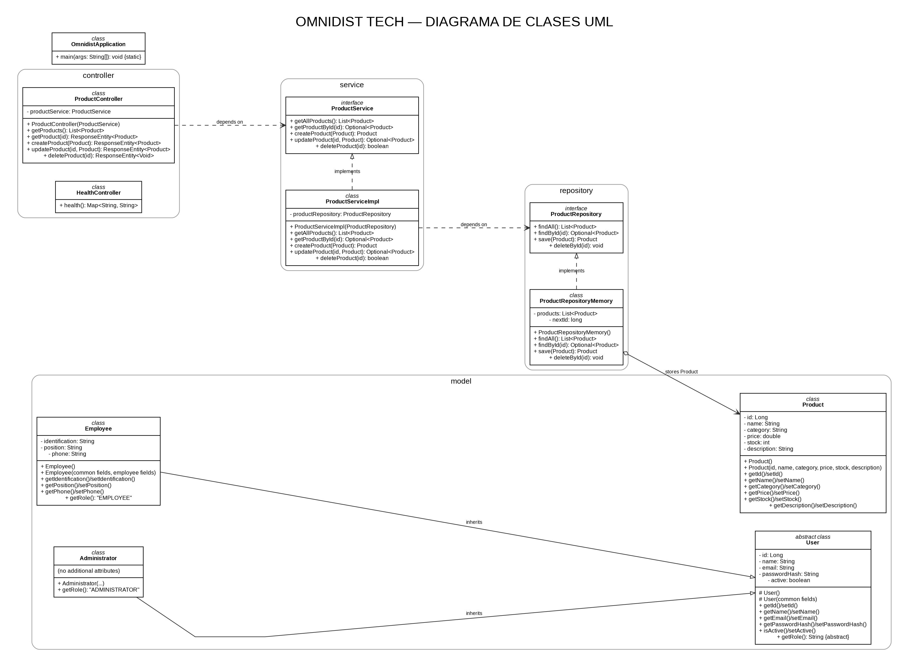

# Arquitectura del proyecto - nivel Backend 1

## Flujo

Frontend -> Controller -> Service -> Repository

## 1. POO

`Product` es una clase que representa un producto. Sus atributos son privados y se accede a ellos mediante métodos (`get` / `set`).

## 2. Inversión de dependencias

`ProductController` no conoce `ProductServiceImpl`; trabaja con la interfaz `ProductService`.

`ProductServiceImpl` tampoco depende directamente de `ProductRepositoryMemory`; trabaja con la interfaz `ProductRepository`.

Por eso las capas de alto nivel dependen de abstracciones.

## 3. Inyección de dependencias

Spring crea los objetos y los entrega mediante el constructor:

```java
public ProductController(ProductService productService) {
    this.productService = productService;
}
```

Y en el servicio:

```java
public ProductServiceImpl(ProductRepository productRepository) {
    this.productRepository = productRepository;
}
```

## 4. Separación de responsabilidades

- Controller: recibe las peticiones HTTP.
- Service: contiene la lógica de la operación.
- Repository: administra los productos.
- Model: representa el objeto Producto.

## 5. Persistencia

En esta primera versión se usa una lista en memoria. No es una base de datos y se reinicia al apagar el servidor. Esto mantiene el proyecto dentro del alcance de la clase actual.

## 6. Modelo de usuarios y POO

`User` es una clase abstracta con los datos comunes de una cuenta. `Employee` y `Administrator` extienden `User`, reutilizan sus atributos y sobrescriben `getRole()` para identificar su tipo. Esto aplica herencia, encapsulación y polimorfismo y elimina la duplicación de los campos comunes. `Product` permanece como una entidad de dominio independiente.

> Alcance actual: estas clases representan el modelo de dominio, pero todavía no hay controladores, servicios ni repositorios de usuarios que permitan administrarlas mediante la API. Tampoco constituyen por sí solas un sistema de autenticación o autorización.

## 7. Diagrama de clases UML

El diagrama fuente editable y sus representaciones se encuentran en esta carpeta:

- `DIAGRAMA_CLASES_UML.puml`: fuente PlantUML.
- `DIAGRAMA_CLASES_UML.png`: imagen para insertar en el informe.
- `DIAGRAMA_CLASES_UML.svg`: imagen vectorial para ampliar sin perder calidad.
- `DIAGRAMA_CLASES_UML.dot`: fuente Graphviz de la representación visual.

Vista previa del diagrama:



El UML distingue las clases implementadas de las relaciones que sí existen en el código. No dibuja asociaciones artificiales entre `Product` y los usuarios.
